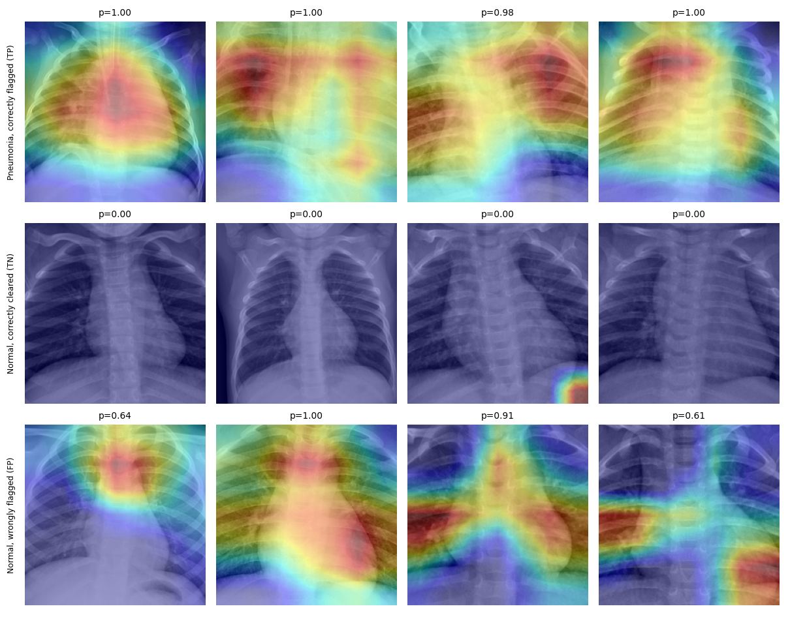

# ChestScan-CNN: Pneumonia Detection from Paediatric Chest X-rays

A ResNet18 classifier for pneumonia versus normal chest X-rays, with Grad-CAM and a Streamlit demo. The main lesson of the project is about evaluation: **in this dataset, image size alone predicts the label**, so a high score does not by itself show that the model reads the lungs.

> **Key findings (official test split, 624 images from 428 patients)**
> - CNN: ROC-AUC **0.968** (95% CI 0.953 to 0.981), sensitivity 0.990, specificity **0.761**.
> - A model that sees **only image width, height and aspect ratio** reaches ROC-AUC **0.895** on the same split.
> - 51% of normal images in the narrowest third by width were wrongly flagged, against 5% in the widest third. Part of the performance, and most of the false alarms, is tied to image size or scale.

This is a research demonstration, not a medical device.

---

## Data

| Item | Detail |
|---|---|
| Source | Kaggle "Chest X-Ray Images (Pneumonia)", from Kermany et al. |
| Patients | Children aged 1 to 5 from Guangzhou Women and Children's Medical Center |
| Labels | Normal or pneumonia (binary) |
| Licence | CC BY 4.0 |
| Copy used | 5,856 images |

Citation: Kermany D.S. et al. *Identifying Medical Diagnoses and Treatable Diseases by Image-Based Deep Learning.* Cell 172(5), 2018.

The images are not included in this repository.

## Data audit (before any training)

1. **The original validation split has only 16 images**, so a new one was built from the training data.
2. **Patient IDs are in the file names, but the numbering is not shared.** 808 numbers appear for both bacterial and viral files, so a patient key must be (type, number). With that key, the original train, validation and test splits share **no patients**. My first attempt used the number alone and reported 264 shared patients, which was a false alarm caused by merging different people.
3. **Exact duplicates:** 30 groups of identical images, all inside one split. 26 duplicate images were removed from train/validation; 6 remain in the official test split, which was left untouched.
4. **Image size leaks the label.** On a sample of 600 training images, normal images average 1658 x 1378 px (aspect 1.22) and pneumonia images 1215 x 838 px (aspect 1.51). A gradient-boosting model using only size and brightness reached ROC-AUC 0.930 (+/- 0.023) in cross-validation. The reason for the difference is unknown.
5. **Brightness differs in train but not in test.** Mean pixel value: train 139.7 (normal) vs 147.8 (pneumonia); test 144.3 vs 145.1. Each image is therefore standardised individually before the network sees it.

### Splits

| Split | Normal | Pneumonia | Patients |
|---|---|---|---|
| Train | 1,156 | 3,306 | 3,146 |
| Validation | 192 | 552 | 523 |
| Test (official) | 234 | 390 | 428 |

Train and validation were split by patient (stratified group split). No patient appears in more than one split.

## Method

- **Preprocessing:** grayscale; shorter side resized to 256 (no stretching); centre crop. This removes the direct effect of image size and aspect ratio, but not differences in scale or sharpness.
- **Training augmentation:** random 224 x 224 crop, rotation of up to 7 degrees. No horizontal flips (the heart is on one side).
- **Model:** ResNet18 pretrained on ImageNet, one output logit.
- **Loss:** binary cross-entropy with `pos_weight` = negatives / positives, because 74% of training images are pneumonia.
- **Optimiser:** AdamW, learning rate 1e-4, weight decay 1e-4, batch size 32, 6 epochs on CPU.
- **Model selection:** the epoch with the best validation ROC-AUC. The test split was evaluated once, at the end.
- **Reference baseline:** gradient boosting on width, height and aspect ratio only.

## Results

| | ROC-AUC | Sensitivity | Specificity | Accuracy |
|---|---|---|---|---|
| Validation (744) | 0.998 | 0.940 | 1.000 | 0.956 |
| **Test (624)** | **0.968** | **0.990** | **0.761** | **0.904** |
| Test 95% CI (patient bootstrap) | 0.953 to 0.981 | 0.978 to 1.000 | 0.703 to 0.815 | n/a |
| Size-only baseline | val 0.931, test 0.895 | | | |

Test confusion matrix at threshold 0.5: 178 normal cleared, 56 normal wrongly flagged, 4 pneumonia missed, 386 pneumonia caught.

**Validation numbers should not be quoted as performance.** The test split is harder: validation comes from the same pool as training, test does not. A threshold chosen on validation (sensitivity of at least 0.99) gave a test sensitivity of 1.000 but a specificity of only 0.436.

### How much is size?

| Normal test images by width | Images | Wrongly flagged at 0.5 |
|---|---|---|
| Narrow (984 to 1611 px) | 78 | 51% |
| Middle (1612 to 1949 px) | 78 | 15% |
| Wide (1952 to 2752 px) | 78 | 5% |

- Within each class the score still correlates with image width (Spearman -0.40 for normal, -0.42 for pneumonia).
- Test ROC-AUC inside aspect-ratio quartiles: 0.989, 0.986, 0.936, 0.925. Inside the width range 1265 to 1640 px (72 normal, 84 pneumonia): 0.890. Groups at the narrowest and widest widths contain too few images of one class to evaluate.
- **Reading:** the model learned signal beyond size (a size-only model would score about 0.5 inside a size-matched group), but its true discrimination is probably closer to 0.89 than to the headline 0.968, and this analysis cannot pin it down more tightly.

### Grad-CAM



Random test examples, not cherry-picked. Grad-CAM shows evidence for the pneumonia output, so correctly cleared normal images are mostly blank. The share of the map in the outer border (49% of the area) is 0.40 for correctly flagged pneumonia and 0.43 for false positives, so attention is not concentrated at the edges. The map is only 7 x 7 in resolution and cannot rule out subtle cues such as image sharpness. Several false positives highlight the central chest region.

## Demo

```
streamlit run app.py
```

Upload a chest X-ray to see the score, the Grad-CAM map and a threshold slider. The second tab shows the metrics and the size analysis. The preprocessing in the app is identical to training; the app's scores match the saved test predictions to five decimal places on the images I checked.

## Repository structure

```
.
├── step2.py             # patient-level split, duplicate removal, size-only baseline -> splits.csv
├── step3a_cache.py      # resize and crop every image once -> cache_256.npy
├── step3c_train.py      # training and evaluation
├── inference.py         # shared preprocessing, prediction and Grad-CAM
├── app.py               # Streamlit demo
├── best_model.pt        # trained weights (about 45 MB)
├── gradcam_examples.png
├── requirements.txt
└── README.md
```

Not in the repository: the image folder, `cache_256.npy` (about 380 MB) and the virtual environment.

## How to reproduce

```bash
pip install -r requirements.txt scikit-learn
```

1. Download the dataset and put the `chest_xray` folder in the project directory.
2. Set the paths at the top of each script, then run `step2.py`, `step3a_cache.py` and `step3c_train.py` in that order. Training took roughly 7 to 12 minutes per epoch on a laptop CPU.
3. Run `streamlit run app.py`.

## Limitations

- One dataset, one hospital, children aged 1 to 5. Not tested on adults or on images from other sources.
- The image size shortcut is only partly neutralised by the preprocessing. Performance on images with a different size distribution is unknown.
- Test specificity is 0.76. With 56 false alarms among 234 normal images, this is not a usable screening tool.
- No external validation, no probability calibration, and no radiologist review of the labels.
- Six epochs, one run, one random seed.

## Next steps

- Train with strong scale augmentation (random resized crops) and with size-matched sampling, and compare with this baseline.
- Evaluate on an independent chest X-ray dataset.
- Calibrate the scores and choose the operating threshold on data that resembles deployment.

## Author

Wasim Akram Janyaro | Software Engineering graduate, Mehran University of Engineering and Technology
 [waseemjanyaro@gmail.com]
